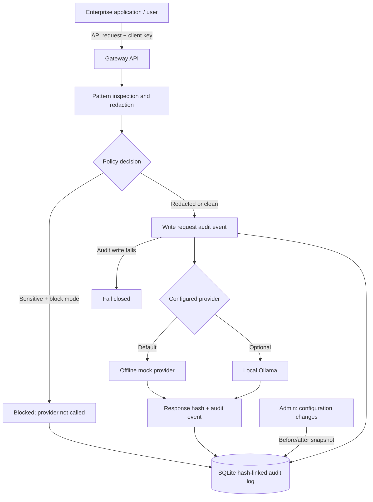

# Sovereign AI Gateway

A local-first proof of concept showing how an application can place a security and audit boundary between users, an LLM provider, and enterprise data.

The gateway accepts an OpenAI-style chat request, checks message content for a few common sensitive-data patterns, then either redacts the detected values or blocks the request. It writes security metadata to a SQLite event log whose entries are linked by SHA-256 hashes. The default model provider is an **offline mock**; optional integration with a locally hosted Ollama instance is included.

> **Status:** educational proof of concept, not a production DLP product, Oracle security scanner, or compliance solution. Detection is regex-based and intentionally limited. Do not use it as the sole control protecting sensitive data.

## Why this project exists

Connecting an LLM to enterprise systems creates more than a prompt-injection problem. Organizations also need to know:

- what information was about to leave their environment;
- whether sensitive values were removed or the request was blocked;
- which user, model and provider were involved;
- whether the AI configuration or policy changed;
- whether the audit history has been modified.

This project demonstrates a small set of controls around those questions. It does **not** connect directly to Oracle yet; the next step could be a narrow, read-only PL/SQL/API adapter with database-side authorization and auditing.

## Architecture



### Current controls

| Control | What the prototype does |
|---|---|
| Client authentication | Requires an API key (`X-API-Key` or `Authorization: Bearer ...`). |
| Admin authentication | Protects configuration and audit endpoints with a separate `X-Admin-Key`. |
| Prompt inspection | Checks for email addresses, phone-like numbers, Pakistani CNIC-shaped values, common API-key formats and simple password assignments. |
| Redaction | Replaces detected values before the provider adapter receives the messages. |
| Block mode | Rejects a request containing detected sensitive values before contacting a provider. |
| Local-first provider | Uses an offline mock by default; optional Ollama calls a configured local endpoint. |
| Data minimization | Does not store raw prompts or model responses in the default `metadata` audit mode. |
| Audit trail | Records keyed prompt fingerprints, categories/counts, decisions, provider/model, response hashes and config before/after snapshots. |
| Tamper evidence | Hash-links events and exposes an endpoint to verify the chain. |
| Fail closed | If the request audit event cannot be written, the gateway does not send the prompt to a model. |

### Important distinction

The hash chain is **tamper-evident**, not immutable. A person who can rewrite the entire SQLite database can also recompute the chain. A production design should periodically sign or externally anchor chain-head hashes, restrict database-file access, ship logs to a separately administered system, and monitor audit-store availability.

## Quick start (Windows PowerShell)

Python 3.11 or newer is required.

```powershell
cd sovereign-ai-gateway
py -3.11 -m venv .venv
.\.venv\Scripts\Activate.ps1
python -m pip install --upgrade pip
pip install -e ".[dev]"
Copy-Item .env.example .env
```

Edit `.env` and replace `CLIENT_API_KEY`, `ADMIN_API_KEY`, and `AUDIT_HMAC_KEY` with long random values. The default provider is `mock`, so no LLM server or internet access is required for the demo.

Start the API:

```powershell
uvicorn sovereign_gateway.main:app --reload
```

Open the interactive API documentation at `http://127.0.0.1:8000/docs`.

### Linux / macOS

```bash
python3.11 -m venv .venv
source .venv/bin/activate
pip install -e '.[dev]'
cp .env.example .env
# Edit .env and replace the example secrets.
uvicorn sovereign_gateway.main:app --reload
```

## Try it

Replace the example key with the value from your `.env` file.

### 1. Send a prompt containing test data

PowerShell:

```powershell
$headers = @{ "X-API-Key" = "local-client-key-change-this" }
$body = @{
  model = "local-demo"
  messages = @(
    @{ role = "user"; content = "Prepare a test greeting for alice@example.com. The test password is password=hunter2." }
  )
} | ConvertTo-Json -Depth 5

Invoke-RestMethod -Method Post `
  -Uri "http://127.0.0.1:8000/v1/chat/completions" `
  -Headers $headers -ContentType "application/json" -Body $body
```

Expected result: HTTP 200, `gateway.policy_action` is `redacted`, and the offline mock confirms that no external model was contacted.

### 2. Inspect the audit log

```powershell
$admin = @{ "X-Admin-Key" = "local-admin-key-change-this" }
Invoke-RestMethod -Uri "http://127.0.0.1:8000/admin/audit" -Headers $admin
```

By default, audit details contain category counts and HMAC fingerprints, not the original or sanitized prompt text.

### 3. Verify the audit chain

```powershell
Invoke-RestMethod -Uri "http://127.0.0.1:8000/admin/audit/verify" -Headers $admin
```

A clean database returns `valid: true`. The automated test suite also modifies an event to demonstrate that verification detects tampering.

### 4. Switch to block mode

```powershell
$body = @{ policy_mode = "block" } | ConvertTo-Json
Invoke-RestMethod -Method Patch `
  -Uri "http://127.0.0.1:8000/admin/config" `
  -Headers $admin -ContentType "application/json" -Body $body
```

Repeat the first request. A detected sensitive value now produces HTTP 403 and a `chat.blocked` event. The provider is not called.

### 5. Enable local Ollama (optional)

Install and run Ollama separately, download a model, then set `OLLAMA_BASE_URL` and `OLLAMA_MODEL` in `.env`. Restart the gateway and switch providers:

```powershell
$body = @{ provider = "ollama" } | ConvertTo-Json
Invoke-RestMethod -Method Patch `
  -Uri "http://127.0.0.1:8000/admin/config" `
  -Headers $admin -ContentType "application/json" -Body $body
```

The gateway sends the **sanitized** messages to the configured Ollama endpoint. The gateway does not call a cloud model. Keep Ollama bound to a trusted local interface and apply host/network access controls; a local model endpoint is not automatically secure.

## API overview

| Method | Endpoint | Access | Purpose |
|---|---|---|---|
| `GET` | `/healthz` | Public | Liveness check |
| `POST` | `/v1/chat/completions` | Client key | Inspect, redact/block, then call provider |
| `GET` | `/admin/config` | Admin key | Read active runtime config |
| `PATCH` | `/admin/config` | Admin key | Change provider, model, policy or audit capture mode |
| `GET` | `/admin/audit` | Admin key | Read recent audit events (`limit` 1–200) |
| `GET` | `/admin/audit/verify` | Admin key | Verify the event hash chain |

Configuration changes are persisted in the SQLite database and are recorded as before/after audit events. To reset the demo to `.env` settings, stop the service, delete the SQLite database file, and start it again.

## Security design notes

See [the threat model](docs/THREAT_MODEL.md) for the assets, trust boundaries, controls and explicit limitations. See [the Oracle integration design](docs/ORACLE_INTEGRATION.md) for a least-privilege approach to exposing approved PL/SQL operations without giving an LLM arbitrary SQL access.

## Tests

```bash
pytest
```

The tests cover redaction, block-mode behavior, authentication, configuration auditing and detection of modified audit events.

## Data handling and known limitations

- `AUDIT_CAPTURE=metadata` is the default. It stores no prompt or response text.
- `AUDIT_CAPTURE=redacted` stores sanitized message content in the audit log. Sanitization is pattern-based and may miss confidential information; enable this only with synthetic data or after a proper privacy review.
- HMAC fingerprints are preferable to plain prompt hashes, but they are still linkable for repeated identical prompts. Protect `AUDIT_HMAC_KEY` and keep it stable if you need to compare fingerprints across restarts.
- Regex detectors have false positives and false negatives. They are examples, not comprehensive PII/secret detection.
- This proof of concept does not implement user/role-level authorization, rate limiting, TLS termination, prompt-injection defenses, Oracle privilege enforcement, database session correlation, multi-tenant isolation, key rotation, signed audit checkpoints or high-availability storage.
- The demo's client/admin keys are shared static secrets. Use a proper identity provider and per-user authorization in a real deployment.
- Do not expose the development server directly to the internet.

## Suggested next steps

1. Add an Oracle adapter that calls a small allowlisted set of read-only PL/SQL procedures; never let a model generate and execute arbitrary SQL with a privileged account.
2. Correlate gateway request IDs with Oracle session/module/client-identifier fields and database audit records.
3. Add signed, externally stored audit checkpoints and a retention/export policy.
4. Add configurable DLP rules and safe handling for structured data, attachments and tool/function arguments.
5. Add an operator UI only after the event schema and access model are agreed.

## License

MIT. See [LICENSE](LICENSE).
