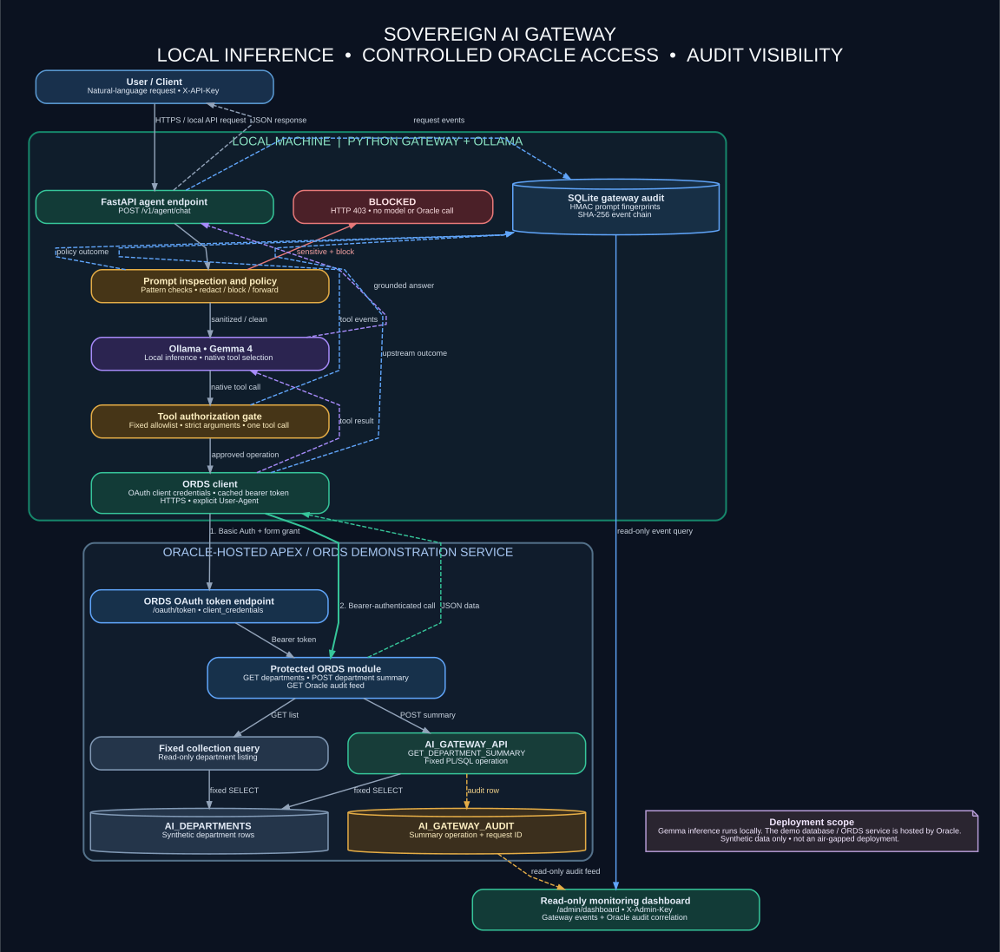

# Architecture

## Overview

Sovereign AI Gateway is a local-first proof of concept that places a policy and tool-authorization layer between a user's natural-language request, a locally hosted language model, and a small set of Oracle APEX/ORDS operations.

The LLM does not receive Oracle credentials and is not given arbitrary SQL access. It may request one of two statically defined tools. The FastAPI gateway validates the function name and arguments, then calls fixed ORDS resources using a server-held OAuth 2.0 client-credentials identity.

> **Deployment context:** The Gemma 4 inference service runs locally through Ollama. The demonstration database and ORDS endpoints use Oracle's hosted APEX service (`oracleapex.com`). This is therefore a local-inference demonstration, not a fully on-premises or air-gapped deployment. All database records in the demonstration are synthetic.

## System diagram



The editable Mermaid source is available at [`diagrams/architecture.mmd`](diagrams/architecture.mmd). A request sequence is available at [`diagrams/sequence.mmd`](diagrams/sequence.mmd).

## Main components

| Component | Responsibility | Trust boundary |
|---|---|---|
| User/client | Sends a natural-language request to the gateway | Untrusted input |
| FastAPI gateway | Authenticates the client, applies prompt policy, coordinates the agent and records audit events | Application control plane |
| Prompt inspector | Detects selected patterns such as email addresses, phone-like values, CNIC-shaped values, simple password assignments and several common API-key formats | Pattern-based control; not comprehensive DLP |
| Ollama / Gemma 4 | Performs local inference and may select one of the tool definitions supplied for the request | Model output is untrusted and must be validated |
| Tool validator | Enforces the fixed tool allowlist and strict argument schemas; limits the current agent flow to one database operation per request | Authorization boundary |
| ORDS client | Obtains/caches a bearer token and calls fixed HTTPS resources | Server-side service identity |
| Oracle ORDS | Enforces the configured OAuth role/privilege and dispatches only the registered REST handlers | Hosted Oracle service boundary |
| PL/SQL package | Executes the approved department-summary query and writes its Oracle audit row | Database execution boundary |
| SQLite audit store | Stores gateway events, HMAC prompt fingerprints and a SHA-256 event chain | Local audit boundary |
| Monitoring dashboard | Read-only view of gateway and Oracle audit data; protected by the administrator key | Administrative boundary |

## Request flow

1. A client submits `POST /v1/agent/chat` with `X-API-Key` and a natural-language message.
2. The gateway assigns a UUID request ID, inspects the prompt and computes an HMAC fingerprint. The raw prompt is not written to the default metadata audit record.
3. If a detector finds a sensitive pattern and the active policy is `block`, the gateway records `agent.request.blocked` and returns HTTP 403 before calling Ollama or ORDS.
4. Under `redact`, detected values are replaced before the prompt is sent to local Ollama. With no finding, the original prompt content is passed to the local model.
5. Gemma 4 receives only the two statically defined tools: `list_departments` and `department_summary`.
6. The gateway checks that exactly one tool call was returned, validates the function name, parses its arguments and rejects unsupported or additional arguments.
7. The ORDS client obtains a token from `/oauth/token` using HTTP Basic authentication and `grant_type=client_credentials`. The token is cached in process memory with an early-refresh margin and retried once after an upstream 401.
8. The gateway calls a fixed ORDS path with `Authorization: Bearer <token>`. The HTTP client sends explicit JSON and User-Agent headers; the current tested User-Agent is `SovereignAIGateway/0.1`.
9. ORDS invokes either a fixed read-only department collection query or the approved `AI_GATEWAY_API.GET_DEPARTMENT_SUMMARY` PL/SQL procedure.
10. The Oracle result is returned to the gateway and supplied to Gemma as a tool result. A second model call generates the user-facing answer with tools disabled.
11. The gateway returns the natural-language answer, structured result, tool name/arguments, source label, policy action and request ID.
12. Gateway events are linked by the same request ID. The department-summary procedure writes a matching Oracle audit row using `GATEWAY_REQUEST_ID`.

See [`diagrams/sequence.mmd`](diagrams/sequence.mmd) for the sequence diagram.

## Approved tools

| Tool | Arguments | ORDS operation | Data returned |
|---|---|---|---|
| `list_departments` | No arguments | `GET /ai-gateway/departments/` | Synthetic department code, name, headcount, monthly budget and currency |
| `department_summary` | `department_code` in `IT`, `HR`, `FIN`, `OPS` | `POST /ai-gateway/department-summary/` | One synthetic department's name, headcount, monthly budget and currency |

The summary endpoint uses POST because the ORDS PL/SQL handler is registered as a POST handler. The operation itself is read-only; it does not insert, update or delete department data. Its audit procedure writes a separate audit record.

The model cannot supply a URL, HTTP method, SQL statement, table name, schema name, package name, or arbitrary procedure name. The route and operation are selected by server-side code.

## HTTP interfaces

### Local FastAPI gateway

| Method | Path | Authentication | Purpose |
|---|---|---|---|
| `GET` | `/healthz` | None | Liveness check |
| `POST` | `/v1/chat/completions` | Gateway client key | OpenAI-style chat endpoint backed by configured local/mock provider |
| `POST` | `/v1/agent/chat` | `X-API-Key` | Gemma tool-calling workflow |
| `GET` | `/v1/oracle/health` | `X-API-Key` | Checks ORDS access via department endpoint |
| `GET` | `/v1/oracle/departments` | `X-API-Key` | Lists synthetic departments |
| `POST` | `/v1/oracle/department-summary` | `X-API-Key` | Retrieves one approved department summary |
| `GET` | `/v1/oracle/tools` | `X-API-Key` | Lists static tool metadata |
| `GET` | `/admin/audit` | `X-Admin-Key` | Gateway audit events |
| `GET` | `/admin/audit/verify` | `X-Admin-Key` | Verifies local audit hash chain |
| `GET` | `/admin/dashboard` | Dashboard page shell | Read-only monitoring UI |
| `GET` | `/admin/dashboard/api/overview` | `X-Admin-Key` | Bounded metrics and audit-integrity status |
| `GET` | `/admin/dashboard/api/events` | `X-Admin-Key` | Filtered gateway audit events |
| `GET` | `/admin/dashboard/api/oracle-audit` | `X-Admin-Key` | Oracle audit feed and matching request IDs |
| `GET` | `/admin/dashboard/api/correlation` | `X-Admin-Key` | Correlated and unmatched records |

### Oracle APEX / ORDS service

Base URL for this demonstration:

```text
https://oracleapex.com/ords/sagdemo
```

| Method | Path | Protection | Purpose |
|---|---|---|---|
| `POST` | `/oauth/token` | OAuth client credentials | Issues the ORDS bearer token |
| `GET` | `/ai-gateway/departments/` | `AI_GATEWAY_READER` / `ai.gateway.access` | Fixed read-only collection query |
| `POST` | `/ai-gateway/department-summary/` | Same ORDS privilege | Calls the read-only PL/SQL summary operation |
| `GET` | `/ai-gateway/audit/` | Same ORDS privilege | Returns the latest Oracle audit rows |

## Audit correlation

The gateway creates a UUID `request_id` for an agent request. The same value is passed as `gateway_request_id` to the Oracle department-summary procedure. The Python dashboard compares these values to correlate gateway and Oracle records.

Current coverage has a known boundary: the `department_summary` PL/SQL operation writes an Oracle audit row; the fixed `list_departments` collection-feed query is read-only and is currently logged by the gateway but does not write an Oracle-side `AI_GATEWAY_AUDIT` row.

The dashboard loads a bounded window: up to 1,000 recent gateway events and up to 100 Oracle audit rows. Its counts should not be interpreted as lifetime totals.

## Configuration

See the root README for the `.env` template. The main settings are:

- `GATEWAY_PROVIDER`, `GATEWAY_MODEL`
- `OLLAMA_BASE_URL`, `OLLAMA_MODEL`, `OLLAMA_AGENT_TIMEOUT_SECONDS`, `OLLAMA_KEEP_ALIVE`
- `CLIENT_API_KEY`, `ADMIN_API_KEY`, `AUDIT_HMAC_KEY`
- `POLICY_MODE`, `AUDIT_CAPTURE`, `DATABASE_PATH`
- `ORDS_ENABLED`, `ORDS_BASE_URL`, `ORDS_CLIENT_ID`, `ORDS_CLIENT_SECRET`, `ORDS_TIMEOUT_SECONDS`

Never put real values in documentation, source files, test fixtures or screenshots.
